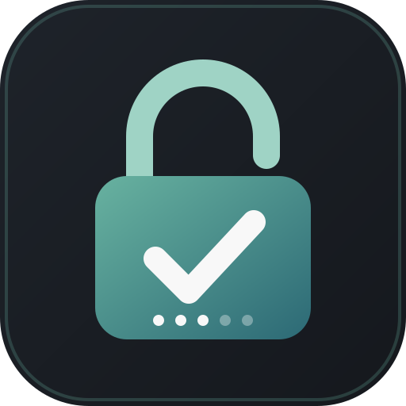

<p align="center">
  
</p>

# ⚔️ Lockout Bot

A production-ready Discord bot for running 1v1 **Codeforces Lockout** matches in real time.

Two players face off on the same set of five Codeforces problems. The first player to get an Accepted (`OK`) submission on Codeforces claims the problem and **locks the opponent out** of its points. When time runs out, the player with the most points wins. If scores are equal, the match converts directly to a **draw**.

---

## 📖 How It Works

1. **Handle Verification:** Players link their Discord account to their Codeforces handle (`/lockout register`). To prove ownership, the player has 5 minutes to submit a **Compilation Error** on CF problem 1A.
2. **Match Rooms:** Matches run in dedicated Discord channels (`room-1`, `room-2`, etc.) created by admins. Practice matches can run in extra practice rooms (`extra-1`, `extra-2`, etc.).
3. **Challenge & Setup:**
   - Challenger runs `/lockout challenge @opponent rating [minutes]`.
   - Base rating $R$ must be a multiple of 100 between 800 and 3100.
   - The bot selects 5 problems of difficulty $R, R+100, R+200, R+300, R+400$, worth **100, 200, 300, 400, and 500 points** respectively (1500 total).
4. **Fair Problem Selection:**
   - Excludes any problem either player has ever submitted to.
   - Checks problem names to filter Div. 1 / Div. 2 twin duplicates.
   - Skips interactive problems.
5. **Live Match & Live Board:**
   - A live embed board shows problem names, links, point values, current standings, and an auto-ticking countdown clock.
   - Players solve and submit directly on Codeforces using their own accounts.
   - Bot continuously polls Codeforces for new accepted submissions and announces points in chat.
6. **Judging Grace Period:**
   - When time expires, a 20-second grace period allows Codeforces to finish judging submissions made in the final seconds.
   - If a submission made before time-up is still queued, the bot waits up to 3 additional minutes.
7. **Match Conclusion:**
   - Higher score wins and advances (in competition rooms).
   - **Ties:** If both players finish with the same score, the match ends directly in a **draw**.
   - Competition results are saved to SQLite; practice match results are not.
8. **Crash & Restart Resilience:**
   - Active match states are persisted in SQLite. If the bot restarts mid-match, it resumes the match loop and board ticker seamlessly upon reconnection.

Detailed competition rules can be found in [LOCKOUT.md](LOCKOUT.md).

---

## 📂 Project Architecture

```
lockout/
├── main.py              # Discord bot entry point, slash commands, match loop, live board
├── cf.py                # Asynchronous Codeforces API client (rate limiting, caching)
├── db.py                # SQLite persistence (users, rooms, active match states, results)
├── tests/
│   └── run_tests.py     # Offline test suite (mock Discord & Codeforces)
├── assets/              # Logo and graphical assets
├── requirements.txt     # Python dependencies
├── LOCKOUT.md           # Detailed player rules and tournament mechanics
├── README.md            # Project documentation and setup guide
├── .env.example         # Example environment configuration
└── lockout.db           # SQLite database (created on first run)
```

### Module Responsibilities

| File | Responsibilities |
|---|---|
| **`main.py`** | • Defines all slash commands (`/lockout ...`)<br>• Manages match lifecycle (`run_match` loop, countdown ticker, judging wait)<br>• Renders interactive Discord UI embeds and board messages<br>• Handles state persistence and match resumption on bot reboot |
| **`cf.py`** | • Async CF API wrapper with token-bucket rate limiting (5 req/sec)<br>• Caches the CF problemset in memory with automated background refresh<br>• Filters problems based on user submission history and twin duplicates<br>• Validates handles via compilation error check on problem 1A |
| **`db.py`** | • SQLite connection with WAL-friendly lightweight schema<br>• Tables for registered `users`, competition `rooms`, `extra_rooms`, `active` matches, and match `results`<br>• Serializes in-flight match state for crash recovery |

---

## 🚀 Getting Started

### 1. Prerequisites
- Python 3.10+
- A Discord Bot Application Token ([Discord Developer Portal](https://discord.com/developers/applications))
  - Bot permissions required: *Manage Channels*, *View Channel*, *Send Messages*, *Embed Links*, *Manage Roles* (optional, for locking rooms).

### 2. Installation

Clone the repository and install dependencies in a virtual environment:

```bash
git clone https://github.com/agarwaladarshcoding-maker/lockout-bot.git
cd lockout-bot

python3 -m venv .venv
source .venv/bin/activate
pip install -r requirements.txt
```

### 3. Configuration

Copy the example environment file:

```bash
cp .env.example .env
```

Configure your `.env` variables:

```ini
# Discord Bot Token (Required)
DISCORD_TOKEN=your_bot_token_here

# Comma-separated Discord User IDs who have bot admin privileges
ADMIN_IDS=123456789012345678,987654321098765432

# Default match duration in minutes (Optional, defaults to 15)
MATCH_MINUTES=15

# SQLite database path (Optional, defaults to lockout.db)
LOCKOUT_DB=lockout.db
```

### 4. Run the Bot

```bash
.venv/bin/python main.py
```

---

## 🧪 Running Tests

The test suite in `tests/run_tests.py` runs completely **offline without Discord or Codeforces credentials**. It simulates real-time match progression, API delays, judging queues, server restarts, and edge cases.

To execute all tests:

```bash
.venv/bin/python tests/run_tests.py
```

Expected output:
```text
PASS  t_accepted_rules  (0.0s)
PASS  t_same_second_uses_submission_id  (0.0s)
PASS  t_points_and_board  (0.0s)
PASS  t_basic_match_winner  (2.9s)
...
PASS  t_tie_ends_in_draw  (3.0s)
PASS  t_zero_zero_tie_ends_in_draw  (3.0s)
...
59 passed, 0 failed
```

---

## 📋 Slash Commands Reference

### 🎮 Player Commands

| Command | Arguments | Description |
|---|---|---|
| `/lockout help` | — | Displays the game rules and list of available commands. |
| `/lockout register` | `handle`, `name` | Link your Codeforces handle and real name. Prompts verification via Compilation Error. |
| `/lockout rooms` | — | Shows all competition and practice rooms and whether they are free or in use. |
| `/lockout challenge` | `@opponent`, `rating`, `[minutes]` | Challenge an opponent in the current room. Base rating must be 800–3100 (step 100). |
| `/lockout score` | — | Displays the current match standings and problem board in this room. |

### 🛠️ Admin Commands

*(Restricted to Discord users listed in `ADMIN_IDS` or users with Administrator permissions)*

| Command | Arguments | Description |
|---|---|---|
| `/lockout createroom` | `count` | Creates $N$ sequential competition rooms (`room-1`, `room-2`, etc.). |
| `/lockout removeroom` | `number` | Deletes a specific competition room by number. |
| `/lockout createextraroom` | `count` | Creates $N$ sequential practice rooms (`extra-1`, `extra-2`, etc.). |
| `/lockout removeextraroom` | `number` | Deletes a specific practice room by number. |
| `/lockout endmatch` | `[room]` | Cancels an ongoing match or pending challenge in the room and frees it. |
| `/lockout technical` | — | Creates a private `#technical` admin channel for running admin commands. |
| `/lockout forceregister` | `@player`, `handle`, `name` | Registers a player without requiring handle verification. |
| `/lockout unregister` | `@player` | Unlinks a player's Discord account and handle. |
| `/lockout players` | — | Lists all registered players, real names, and CF handles. |
| `/lockout matches` | — | Lists historical match results, scores, winners, and draws. |
| `/lockout health` | — | Checks Discord latency, CF API status, SQLite database, and live matches. |

---

## 🤝 Contributing & Collaborating

1. Ensure all code changes pass the test suite: `.venv/bin/python tests/run_tests.py`.
2. Follow PEP 8 style standards.
3. Commit with descriptive messages.
